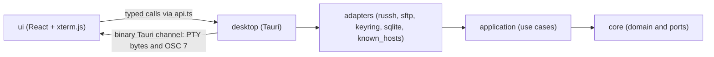

# tukitermlulu

Open-source SSH/SFTP desktop client inspired by MobaXterm, built with Tauri.

[](https://github.com/Leuname0410/tukitermlulu/actions/workflows/ci.yml)
[](LICENSE)

## Demo

<!-- TODO(human): record demo.gif -->


## Features

- Saved sessions organized in folders.
- Authentication with password, PEM/PPK private keys and passphrases.
- Terminal powered by xterm.js.
- SFTP sidebar: list files, upload by dragging and dropping, download, rename, chmod and a transfer queue.
- Terminal working-directory tracking for bash, zsh, fish, PowerShell and cmd.
- Export of a diagnostic bundle.

SSH tunnels are not part of this version.

## Architecture



The codebase follows a hexagonal architecture: `core` holds the domain and the ports (for example `SshTransport`, `RemoteFileSystem`, `KeyLoader`, `SecretStore` and `HostKeyVerifier`), use cases depend only on `core`, adapters implement those ports, and `desktop` wires everything together. Terminal bytes never travel through React state: they go from the Tauri backend to xterm.js over a binary Tauri channel, with OSC 7 sequences tracked separately for the remote working directory.

## Security

- Passwords are stored only in the operating system keyring; passphrases live in backend memory for the lifetime of a tab and are never persisted.
- The host fingerprint is verified before any credential is sent.
- Passwords, passphrases and private keys are wrapped in `Zeroizing`/`SecretString`.
- Logs are redacted: no secrets, terminal bytes or file contents are logged; remote paths appear only at debug level.
- A strict content security policy is applied to the UI.

## Design decisions

Statuses are transcribed from the ADR files.

| ADR | Title | One line | Status |
|---|---|---|---|
| [ADR-001](docs/adr/ADR-001-stack.md) | Technology stack | Rust core, Tauri desktop and React UI. | Propuesto |
| [ADR-002](docs/adr/ADR-002-hexagonal.md) | Hexagonal architecture | Ports in `core`, use cases in `application`, adapters at the edge. | Propuesto |
| [ADR-003](docs/adr/ADR-003-carga-de-llaves.md) | Private key loading with `russh` | PEM, PKCS#8 and PPK keys loaded through `russh`. | Propuesto |
| [ADR-004](docs/adr/ADR-004-secretos.md) | Secrets policy | Passwords in the OS keyring, passphrases only in memory. | Propuesto |
| [ADR-005](docs/adr/ADR-005-plano-de-datos-terminal.md) | Verified handshake and terminal data plane | Verify the host key first, then stream PTY bytes over the SSH port. | Propuesto |
| [ADR-006](docs/adr/ADR-006-shell-integration.md) | Remote directory tracking | Shell integration injected into the PTY for bash, zsh, fish, PowerShell and cmd. | Propuesto |
| [ADR-007](docs/adr/ADR-007-tuneles.md) | SSH tunnels | Planned for F8; not available in this version. | Propuesto |

## Measured KPIs

| Metric | Result |
|---|---|
| Connection time (LAN/container) | 19.7 ms |
| Keystroke to echo, p95 | 0.4 ms |
| SFTP throughput | 1.31× OpenSSH `sftp` |
| Cold start (Windows) | ~390 ms |
| Idle RAM with one session (Windows, WebView2; see [RAM report](docs/ram-report.md)) | 177 MB |
| Installer | NSIS 4.49 MB / MSI 6.44 MB |
| Coverage | core + application 98.1% / adapters 87.8% |

Measured on Windows 11 against the Docker test server. Sources: `just kpi`, `just e2e`, `just coverage` and T-33a.

## Install

Download the installer for your platform from the [Releases](https://github.com/Leuname0410/tukitermlulu/releases) page and verify it with the `SHA256SUMS.txt` file published in the same release.

On Linux and macOS:

```sh
sha256sum -c SHA256SUMS.txt
```

On Windows (PowerShell), compare the output with the corresponding line of `SHA256SUMS.txt`:

```powershell
Get-FileHash .\tukitermlulu_*.msi -Algorithm SHA256
Get-FileHash .\tukitermlulu_*-setup.exe -Algorithm SHA256
```

### macOS

Builds are not notarized or signed by Apple. If Gatekeeper blocks the app, right-click it and choose **Open**, or remove the quarantine attribute after moving it to Applications:

```sh
xattr -dr com.apple.quarantine /Applications/tukitermlulu.app
```

### Windows

Builds are not code-signed. When SmartScreen warns about the installer, choose **More info** → **Run anyway**.

### Linux

Make the AppImage executable:

```sh
chmod +x *.AppImage
```

Or install the Debian package:

```sh
sudo apt install ./tukitermlulu_*.deb
```

## Development

Requirements: Rust stable, Node LTS, Docker and `just`.

- `just dev` — run the app in development mode.
- `just check` — formatting, clippy, tests, audit, deny, ESLint and Vitest.
- `just test-int` — integration tests against the Docker test server.
- `just kpi` — connection, keystroke and SFTP measurements.
- `just coverage` — coverage report.
- `just e2e` — end-to-end tests.
- `just bundle` — build the installers.

## How it was built

Work was split into small tickets, each implemented with strict TDD: a failing test commit (`test:`) before the minimal implementation commit (`feat:` or `fix:`), with a generator producing the change and a reviewer checking it. `just check` was the mandatory gate before delivery; the ticket-by-ticket record is in [docs/progress.md](docs/progress.md).

## License

[MPL-2.0](LICENSE).
